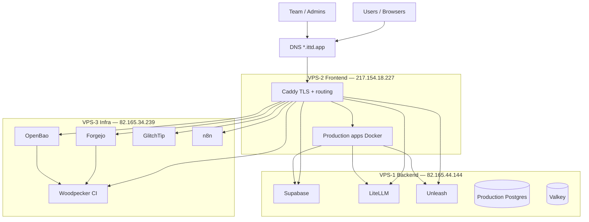

# ITTD Platform Landscape — IONOS 3-VPS Orchestration

**Purpose:** Copy this file into any project repository that deploys to the ITTD production platform. Use it to decide where your service runs, which platform APIs it uses, how secrets and CI/CD work, and what to coordinate with the **IONOS Infra** repo.

**Infra source of truth:** `IONOS Infra` (Ansible playbooks, Caddy routes, server layout, runbooks in `Plan/`).

**Domain:** `*.ittd.app` — all public DNS **A records point to VPS-2 Frontend** (`217.154.18.227`).

**Last updated:** 2026-10-12

---

## 1. How to use this document

| If you are building… | Start here |
|---|---|
| A **user-facing web app** (Next.js, SPA, API behind browser) | §4 Placement decision tree → §7 Production app onboarding |
| A **backend-only service** (API, worker, shared dependency) | §4 + §6 Platform services catalog |
| **CI/CD** for your repo (build, push image, deploy) | §9 CI/CD model |
| **Secrets / env vars** for build or runtime | §8 Secrets (OpenBao) |
| **Monitoring / error tracking** | §6 GlitchTip + §10 Observability |
| **Infra changes** (new hostname, firewall, Ansible role) | §11 Responsibility split → coordinate in IONOS Infra |

**Project-specific example:** CVForge has a detailed handoff doc at `Plan/cvforge-deployment-reference.md` in the infra repo — use it as a template for depth when your project is similarly complex.

---

## 2. Architecture at a glance

Three IONOS VPS (Linux L), managed from a Fedora workstation via Ansible. **Only VPS-2 exposes public HTTP/HTTPS.** Backend and Infra services are reached through Caddy on VPS-2 over a WireGuard mesh.

```text
Internet
   │
   ▼
DNS (*.ittd.app → 217.154.18.227)
   │
   ▼
VPS-2 Frontend — Caddy :443/:80  [sole public HTTP entry]
   │
   ├── Local Docker (gateway_default network)
   │     ├── Production apps (CVForge, AIACC, Parsr, …)
   │     └── Caddy reverse-proxies to local containers
   │
   ├── WireGuard 10.44.0.1 — VPS-1 Backend
   │     ├── Supabase, LiteLLM, Unleash
   │     ├── Production Postgres (:5432, private)
   │     └── Valkey (:6379, private)
   │
   └── WireGuard 10.44.0.3 — VPS-3 Infra / DevOps
         ├── OpenBao, Forgejo, Woodpecker, GlitchTip, n8n
         └── Infra Postgres lives on Backend (:5433, private)
```



---

## 3. Servers and access

| Role | SSH / admin alias | Public IP | WireGuard IP | Hosts |
|---|---|---:|---:|---|
| **Backend** | `ts-ionos-backend` | `82.165.44.144` | `10.44.0.1` | Data + shared backend APIs |
| **Frontend** | `ts-ionos-frontend` | `217.154.18.227` | `10.44.0.2` | Caddy + production apps |
| **Infra** | `ts-ionos-infra` | `82.165.34.239` | `10.44.0.3` | Git, CI, secrets, monitoring, automation |

- **Admin access:** Tailscale SSH to `ts-ionos-*` aliases (split-tunnel VPN step zero before SSH lockdown).
- **Server-to-server traffic:** WireGuard mesh `10.44.0.0/24`, UDP `51820`.
- **Public SSH:** Restricted to admin VPN / emergency sources only — not open to the internet.

Backup public-IP SSH aliases (`ionos-backend`, `ionos-frontend`, `ionos-infra`) exist for bootstrap; Ansible inventory uses Tailscale names.

---

## 4. Where does your project go?

Use this decision tree before writing Docker Compose or CI pipelines.

```text
Is it a tool for the whole company (git, CI, secrets, monitoring)?
  └─ YES → VPS-3 Infra. New hostname via Caddy on VPS-2. Secrets under infra/*.
           Infra Postgres on Backend (10.44.0.1:5433). Ansible role in IONOS Infra.

Is it a shared backend API used by multiple production apps (auth, AI proxy, flags)?
  └─ YES → VPS-1 Backend. Exposed via Caddy subdomain or internal WireGuard only.
           Production Postgres or dedicated service. Secrets under prod/* or infra/*.

Is it a production application users visit in a browser?
  └─ YES → VPS-2 Frontend. Container on gateway_default Docker network.
           Public URL https://<app>.ittd.app. CI deploys image to Frontend.

Is it only called by other containers on Frontend (not public)?
  └─ YES → VPS-2 Frontend, same Docker network, no public route (or Caddy basic auth).
           Call via Docker DNS: http://<container>:<port>.

Does it need its own database?
  └─ Production app data → Production Postgres on Backend (new DB/user via infra).
  └─ Platform/tool data   → Infra Postgres on Backend (new DB/user via infra).
  └─ Never run a separate public database port.
```

### Placement summary

| Tier | VPS | Typical workloads | Public exposure |
|---|---|---|---|
| **Production apps** | VPS-2 Frontend | Web apps, internal APIs co-located with apps | Via Caddy only |
| **Product backend** | VPS-1 Backend | Supabase, LiteLLM, Unleash, caches | Caddy subdomain or private WG |
| **Platform / DevOps** | VPS-3 Infra | Forgejo, Woodpecker, OpenBao, GlitchTip, n8n | Caddy subdomain; admin auth |

---

## 5. Public URLs and routing

All hostnames resolve to **Frontend public IP**. Caddy terminates TLS and proxies upstream.

| Hostname | Upstream location | Purpose | Access tier |
|---|---|---|---|
| `www.ittd.app` | VPS-2 static | Service directory + health/update badges | Team (Caddy basic auth) |
| `cvforge.ittd.app` | VPS-2 `cvforge:3001` | CVForge production app | Public (app auth) |
| `aiacc.ittd.app` | VPS-2 `aiacc:3000` | EU AI Act compliance app | Public |
| `parsr.ittd.app` | VPS-2 Parsr API + UI | Document parsing | Team (Caddy basic auth) |
| `supabase.ittd.app` | VPS-1 Kong `:8000` | Supabase API | Public API |
| `studio.ittd.app` | VPS-1 Kong `:8000` | Supabase Studio | Admin |
| `proxy.ittd.app` | VPS-1 LiteLLM `:4000` | AI model proxy | Server-side / admin |
| `flags.ittd.app` | VPS-1 Unleash `:4242` | Feature flags | Admin + server SDK |
| `secrets.ittd.app` | VPS-3 OpenBao `:8200` | Secrets manager | Admin / deployment |
| `git.ittd.app` | VPS-3 Forgejo `:3000` | Source control | Team |
| `ci.ittd.app` | VPS-3 Woodpecker `:8000` | CI/CD | Team |
| `monitor.ittd.app` | VPS-3 GlitchTip `:8080` | Errors + uptime | Admin |
| `automate.ittd.app` | VPS-3 n8n `:5678` | Workflow automation | Admin |

**Adding a new public hostname:** request DNS A record → Frontend IP, Caddy block in `ansible/roles/caddy/templates/Caddyfile.j2`, deploy via `ansible-playbook playbooks/gateway.yml`.

---

## 6. Platform services catalog

Use these shared services instead of reinventing them in your project.

### Source control — Forgejo (`git.ittd.app`)

| Item | Value |
|---|---|
| URL | `https://git.ittd.app` |
| Host | VPS-3 Infra |
| Your action | Create org/repo; set `origin` to Forgejo remote |
| Secrets | `infra/forgejo` (infra-managed) |

### CI/CD — Woodpecker (`ci.ittd.app`)

| Item | Value |
|---|---|
| URL | `https://ci.ittd.app` |
| Host | VPS-3 Infra (server + agents on same host initially) |
| Flow | `Forgejo push → webhook → Woodpecker → build/deploy` |
| Your action | Add `.woodpecker.yml` (or pipeline config) in **your project repo** |
| Secrets | CI reads OpenBao via scoped token; never commit credentials |
| Deploy targets | SSH or Docker on `ts-ionos-frontend` (apps) or other VPS as agreed |

**Pipeline stages (typical production app):**

1. **Lint / test** — on agent
2. **Build** — `docker build` with build-time args (`NEXT_PUBLIC_*` for Next.js)
3. **Push** — registry (Docker Hub, Forgejo registry, etc.) with immutable tag (`:git-sha`, `:v1.2.3`)
4. **Deploy** — `docker compose pull && up -d` on target host, or scripted rollout

Pin image tags in production. Avoid `latest` for prod services.

### Secrets — OpenBao (`secrets.ittd.app`)

| Item | Value |
|---|---|
| URL | `https://secrets.ittd.app` |
| Host | VPS-3 Infra (`10.44.0.3:8200`, WireGuard only; HTTPS via Caddy) |
| KV mounts | `prod/`, `infra/`, `shared/` |
| Flow | `Admin/CI → OpenBao → sync script → server .env → Docker Compose` |

**Path conventions:**

| Mount | Pattern | Examples |
|---|---|---|
| `prod/` | Per production app or product backend | `prod/cvforge`, `prod/supabase`, `prod/litellm` |
| `infra/` | Platform services | `infra/forgejo`, `infra/woodpecker`, `infra/postgres/<app>` |
| `shared/` | Cross-cutting | `shared/smtp` (Brevo) |

**Rules:** Never commit secrets. Never log secrets in CI, Caddy access logs, or GlitchTip events. Scope Woodpecker tokens to required paths only.

### Auth & data — Supabase (`supabase.ittd.app`)

| Item | Value |
|---|---|
| Host | VPS-1 Backend (self-hosted stack) |
| Use when | App needs auth, Postgres via Supabase client, storage, realtime |
| Client URL | `https://supabase.ittd.app` |
| Keys | `prod/supabase` → `anon_key` (build/client), `service_role_key` (server only) |
| Coordination | OAuth redirect URLs must include your app hostname (e.g. `https://myapp.ittd.app/auth/callback`) |

### AI proxy — LiteLLM (`proxy.ittd.app`)

| Item | Value |
|---|---|
| Host | VPS-1 Backend |
| Image | `ghcr.io/berriai/litellm:v1.105.0` (pinned; bump via Ansible) |
| Use when | Server-side LLM calls; OpenRouter key stays in infra |
| Public URL | `https://proxy.ittd.app` |
| Internal URL | `http://10.44.0.1:4000` |
| Auth (API) | `Authorization: Bearer <master_key>` from `prod/litellm` |
| Auth (UI) | `ui_username` / `ui_password` from `prod/litellm` (bootstrap); prefer a personal `proxy_admin` account |
| Chat models | `POST /v1/chat/completions` |
| Decision models (e.g. Jev) | `POST /v1/systemone` or `/v1/decisions` — **not** chat completions |
| Rule | **Never** expose OpenRouter or master key to browser / `NEXT_PUBLIC_*` |
| Ops | Upgrade / `.env` lessons: `Plan/05-implementation-phases/05-backend-product-services.md` § LiteLLM image upgrades |

### Feature flags — Unleash (`flags.ittd.app`)

| Item | Value |
|---|---|
| Host | VPS-1 Backend |
| Use when | Gradual rollouts, toggles without redeploy |
| API | Create project token in UI → store in `prod/<yourapp>` |

### Error tracking — GlitchTip (`monitor.ittd.app`)

| Item | Value |
|---|---|
| Host | VPS-3 Infra |
| Protocol | Sentry-compatible SDK |
| Your action | Create project in GlitchTip → DSN in `prod/<yourapp>` → `SENTRY_DSN` or `NEXT_PUBLIC_SENTRY_DSN` |
| Note | Client-side DSN must be set at **build time** for Next.js |

### Automation — n8n (`automate.ittd.app`)

| Item | Value |
|---|---|
| Host | VPS-3 Infra |
| Use when | Alert routing, scheduled health summaries, approved runbook actions |
| Typical integrations | GlitchTip webhooks, Forgejo issues, notifications |

### Email — Brevo SMTP

| Item | Value |
|---|---|
| Config | `shared/smtp` in OpenBao |
| Used by | Supabase GoTrue, app transactional mail |

---

## 7. Production app onboarding (VPS-2)

Follow this checklist when adding a new user-facing application.

### 7.1 Prerequisites

- [ ] Repo hosted on Forgejo (`git.ittd.app/<org>/<repo>`)
- [ ] Hostname chosen: `<app>.ittd.app` (DNS A → `217.154.18.227`)
- [ ] Placement confirmed (§4) — default is VPS-2 Frontend
- [ ] OpenBao path created: `prod/<app>/` for runtime secrets
- [ ] GlitchTip project created (optional but recommended)

### 7.2 Docker conventions on Frontend

| Item | Convention |
|---|---|
| Compose project dir | `/opt/cvforge/<app>/` (or agreed path) |
| Docker network | **`gateway_default`** (external) — shared with Caddy |
| Container naming | Stable name matching Caddy upstream (e.g. `myapp`) |
| Port binding | **Do not** publish app ports to `0.0.0.0` — Caddy is the only public listener |
| Internal service calls | Use Docker DNS on `gateway_default` (e.g. `http://parsr:3001`) |

Example compose fragment:

```yaml
services:
  myapp:
    image: <registry>/myapp:<tag>
    container_name: myapp
    restart: unless-stopped
    env_file:
      - .env.production
    networks:
      - gateway_default

networks:
  gateway_default:
    external: true
```

### 7.3 Build-time vs runtime (Next.js and similar)

| Variable prefix | When read | Where to set |
|---|---|---|
| `NEXT_PUBLIC_*` | **Build time** (baked into client bundle) | CI `docker build` args / build env |
| Server-only env | **Runtime** (container start) | `.env.production` on host, synced from OpenBao |

Rebuilding the image is required for any client-visible URL or public key change.

### 7.4 Caddy route (infra repo)

Infra adds (or you coordinate):

```caddy
myapp.ittd.app {
    reverse_proxy myapp:3000 {
        header_up Host {host}
        header_up X-Forwarded-Proto https
        header_up X-Forwarded-Host {host}
    }
}
```

Deploy: `ansible-playbook playbooks/gateway.yml` from IONOS Infra.

### 7.5 Gateway authentication tiers

| Tier | Mechanism | Examples |
|---|---|---|
| **Public app** | Application's own auth (e.g. Supabase) | `cvforge.ittd.app`, `aiacc.ittd.app` |
| **Team / ops** | Caddy HTTP basic auth | `www.ittd.app`, `parsr.ittd.app` |
| **Admin tools** | Strong auth + prefer VPN/IP restrict | `studio.ittd.app`, `flags.ittd.app`, `secrets.ittd.app` |

Gateway basic auth credentials live in OpenBao (`prod/www`, `prod/parsr`, etc.) and sync to Caddy snippets.

---

## 8. Secrets workflow for your project

### 8.1 Create your OpenBao path

Work with infra admin to create `prod/<yourapp>/` with keys your app needs, for example:

| Key | Usage |
|---|---|
| `api_internal_secret` | Server-to-server auth |
| `glitchtip_dsn` | Error tracking |
| `unleash_api_token` | Feature flags |
| App-specific API keys | As required |

Product-wide secrets (Supabase, LiteLLM) stay in `prod/supabase`, `prod/litellm` — reference, do not duplicate.

### 8.2 CI access

Woodpecker uses a read-only OpenBao policy scoped to:

- `prod/<yourapp>/*` for deploy secrets
- Any build-time secrets (e.g. `anon_key` for `NEXT_PUBLIC_SUPABASE_ANON_KEY`)

Inject via pipeline secrets or `bao kv get` in a controlled step — never echo values.

### 8.3 Runtime on server

Infra may provide a sync script pattern (`sync-<app>-from-openbao.sh`) that writes `.env.production` with mode `600`. Your compose file references `env_file: .env.production`.

---

## 9. CI/CD model

```text
Developer → git push → Forgejo → Woodpecker webhook
                                    │
                    ┌───────────────┼───────────────┐
                    ▼               ▼               ▼
                 test            docker build      (optional) scan
                    │               │
                    │               ▼
                    │            push image
                    │               │
                    └───────────────┼───────────────┘
                                    ▼
                          deploy to target VPS
                          (compose pull/up, SSH)
```

| Responsibility | Owner |
|---|---|
| Application source code | **Your project repo** |
| `.woodpecker.yml`, Dockerfile, tests | **Your project repo** |
| Image build args, registry push | **Your project repo** (CI) |
| Server directories, Caddy routes, firewall | **IONOS Infra** (Ansible) |
| OpenBao paths, policies, sync scripts | **IONOS Infra** (+ your keys in `prod/<app>`) |
| Platform services (Forgejo, Woodpecker, OpenBao) | **IONOS Infra** |

**Git remote example:** `https://git.ittd.app/<org>/<repo>.git`

**CI UI:** `https://ci.ittd.app`

---

## 10. Observability

| Concern | Tool | Your action |
|---|---|---|
| Exceptions | GlitchTip (`monitor.ittd.app`) | Add Sentry SDK; DSN from `prod/<app>` |
| Uptime / SSL | GlitchTip checks | Infra configures; provide health URL |
| Alert workflows | n8n (`automate.ittd.app`) | Optional — infra-led |
| Logs | Container stdout + Caddy access logs | No secrets in logs; no full AI prompts in access logs |

**Health endpoints:** Expose `GET /` or `GET /api/health` for smoke tests and monitoring.

---

## 11. Responsibility split

| Change type | Where it lives |
|---|---|
| App business logic, UI, API routes | Project repo |
| Dockerfile, multi-stage build, `NEXT_PUBLIC_*` | Project repo |
| Woodpecker pipeline | Project repo (`.woodpecker.yml`) |
| Compose layout on server (if standardized) | Infra Ansible role **or** project deploy script |
| New subdomain, TLS, reverse proxy | Infra `roles/caddy` |
| WireGuard, nftables, IONOS firewall | Infra playbooks |
| New Postgres database/user | Infra Phase 4 patterns / admin request |
| OpenBao mount, policy, sync script | Infra |

**Rule of thumb:** If it runs on every deploy from your code, it belongs in your repo. If it is shared platform or server shape, it belongs in IONOS Infra.

---

## 12. Security rules (non-negotiable)

- Public `80`/`443` **only** on VPS-2 Caddy.
- Databases and Valkey are **never** public.
- Docker services bind to `127.0.0.1`, WireGuard IP, or container network — not `0.0.0.0` for app/db ports.
- Admin UIs require authentication; prefer VPN/IP restriction where possible.
- OpenBao human access requires MFA (TOTP) before production secrets.
- Production images are **pinned**; updates are deliberate Ansible or CI deploys, not auto-`latest` / Watchtower.
- Image bumps: change role `defaults/main.yml`, ensure compose **pulls** before recreate, keep `platform-status.py` pins in sync, deploy from `ansible/`.
- Never overwrite live OpenBao-backed `.env` files with Ansible skeletons on every run.
- Woodpecker agents with Docker socket access are **privileged** — isolate credentials.

---

## 13. Current production inventory

| Service | URL | Host | Status | Owning project / notes |
|---|---|---|---|---|
| Service directory | `www.ittd.app` | VPS-2 | Live | Infra — health + version badges (30 min refresh) |
| AIACC | `aiacc.ittd.app` | VPS-2 | Live | AIACC repo |
| Parsr | `parsr.ittd.app` (auth) | VPS-2 | Live | Shared; CVForge uses internal `parsr:3001` |
| CVForge | `cvforge.ittd.app` | VPS-2 | Planned | CVForge repo — see `Plan/cvforge-deployment-reference.md` |
| Supabase | `supabase.ittd.app` | VPS-1 | Live | Platform — CVForge consumer |
| Supabase Studio | `studio.ittd.app` | VPS-1 | Live | Admin |
| LiteLLM | `proxy.ittd.app` | VPS-1 | Live | Platform — `v1.105.0` |
| Unleash | `flags.ittd.app` | VPS-1 | Live | Platform — pin `6.9.0` (behind upstream 8.x) |
| OpenBao | `secrets.ittd.app` | VPS-3 | Live | Platform |
| Forgejo | `git.ittd.app` | VPS-3 | Live | Platform — LTS `15.0.x` |
| Woodpecker | `ci.ittd.app` | VPS-3 | Live | Platform |
| GlitchTip | `monitor.ittd.app` | VPS-3 | Live | Platform |
| n8n | `automate.ittd.app` | VPS-3 | Live | Platform — `2.42.7` |

---

## 14. New project quick-start checklist

Copy into your project's README or deployment doc and tick off:

- [ ] Read §4 — confirm VPS placement
- [ ] Create Forgejo repository under `git.ittd.app`
- [ ] Request / create `prod/<app>/` in OpenBao
- [ ] Choose `<app>.ittd.app` hostname; confirm DNS
- [ ] Add Dockerfile and `.woodpecker.yml` (build → push → deploy)
- [ ] For Next.js: separate `NEXT_PUBLIC_*` (build) from server secrets (runtime)
- [ ] Join `gateway_default` on Frontend if user-facing
- [ ] Coordinate Caddy route in IONOS Infra
- [ ] Create GlitchTip project; wire DSN
- [ ] Document Supabase redirects / LiteLLM / Unleash integration if used
- [ ] Smoke test HTTPS, auth, health, error reporting
- [X] Update `www.ittd.app` service directory (infra) — health/update badges live

---

## 15. Related documents (IONOS Infra repo)

| Document | Topic |
|---|---|
| `Plan/02-three-server-service-layout.md` | Full architecture and DNS table |
| `Plan/03-network-firewall-policy.md` | Firewall and access policy |
| `Plan/06-wireguard-server-network.md` | WireGuard mesh |
| `Plan/cvforge-deployment-reference.md` | Detailed app handoff example |
| `ansible/README.md` | Ansible entry points and playbooks |
| `PROJECT_SUMMARY.md` | Repo overview and phase list |

---

## 16. Coordination contacts

Platform changes (new hostname, DB, OpenBao policy, Caddy route) require a ticket or PR in **IONOS Infra**. Application changes (image, env, pipeline) live in **your project repo**.

When opening an infra request, include:

1. App name and Forgejo repo URL
2. Target VPS and hostname
3. Container port and image name pattern
4. OpenBao path and required keys
5. Dependencies (Supabase, LiteLLM, Parsr, etc.)
6. Public vs team-only vs admin-only access

---

*This file is maintained in the IONOS Infra repository. Copy it into downstream projects and add a project-specific section below when you customize it.*

### Project-specific notes

<!-- Add your app name, repo URL, hostname, and env mapping below -->
