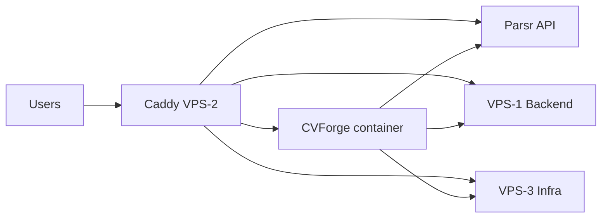

# CVForge deployment reference — IONOS 3-VPS topology

**Purpose:** Transfer this file into the CVForge project repository. Use it when configuring build-time env, runtime env, Docker Compose, and Woodpecker CI for deployment to production.

**Infra repo:** `IONOS Infra` (Ansible + plans) — CVForge image build and deploy pipeline live in the **CVForge** repo.

**Status (2026-06-09):** Backend (Supabase, LiteLLM, Unleash), Infra platform (Forgejo, Woodpecker, GlitchTip, n8n), Frontend apps (AIACC, Parsr) are live. **CVForge** is the remaining Phase 7 app — deploy from the CVForge project after rebaking config into a new image.

---

## 1. Architecture at a glance

```text
Internet
   │
   ▼
DNS → 217.154.18.227 (VPS-2 Frontend) — Caddy :443/:80  [only public HTTP entry]
   │
   ├── Local Docker (gateway_default network)
   │     ├── cvforge:3001          ← YOU deploy here
   │     ├── parsr:3001            ← document parsing API (live)
   │     ├── parsr-ui:80           ← ops UI (Caddy basic auth)
   │     └── aiacc:3000            ← standalone app (live)
   │
   ├── WireGuard 10.44.0.1 (VPS-1 Backend)
   │     ├── supabase Kong :8000   → supabase.ittd.app, studio.ittd.app
   │     ├── litellm :4000         → proxy.ittd.app
   │     ├── unleash :4242         → flags.ittd.app
   │     ├── postgres-prod :5432   (private)
   │     └── valkey :6379          (private, localhost)
   │
   └── WireGuard 10.44.0.3 (VPS-3 Infra)
         ├── openbao :8200          → secrets.ittd.app
         ├── forgejo :3000          → git.ittd.app
         ├── woodpecker :8000       → ci.ittd.app
         ├── glitchtip :8080        → monitor.ittd.app
         └── n8n :5678              → automate.ittd.app
```



---

## 2. Servers and WireGuard

| Role | Tailscale / SSH alias | Public IP | WireGuard IP |
|---|---|---:|---:|
| Backend | `ts-ionos-backend` | `82.165.44.144` | `10.44.0.1` |
| Frontend | `ts-ionos-frontend` | `217.154.18.227` | `10.44.0.2` |
| Infra | `ts-ionos-infra` | `82.165.34.239` | `10.44.0.3` |

Mesh: `10.44.0.0/24`, UDP `51820`. App ports on Backend/Infra are **not** public; Caddy on Frontend proxies over WireGuard.

---

## 3. Public URLs (all via Caddy on Frontend)

| Hostname | Service | CVForge relevance |
|---|---|---|
| `cvforge.ittd.app` | **CVForge** (you deploy) | App URL, auth callbacks, `NEXT_PUBLIC_*` |
| `supabase.ittd.app` | Supabase API (Kong) | `NEXT_PUBLIC_SUPABASE_URL` |
| `studio.ittd.app` | Supabase Studio | Admin DB/auth UI (Kong basic-auth) |
| `proxy.ittd.app` | LiteLLM | AI proxy (server-side) |
| `flags.ittd.app` | Unleash | Feature flags (server + optional client SDK) |
| `monitor.ittd.app` | GlitchTip | Error tracking DSN |
| `parsr.ittd.app` | Parsr UI + API | Ops only (Caddy basic auth); CVForge uses **internal** `parsr:3001` |
| `git.ittd.app` | Forgejo | Source repo |
| `ci.ittd.app` | Woodpecker | CI/CD pipelines |
| `www.ittd.app` | Service directory | Caddy basic auth (team) |
| `aiacc.ittd.app` | AIACC | Unrelated standalone app |

DNS: all `*.ittd.app` **A records → `217.154.18.227`** (Frontend).

---

## 4. Where CVForge runs

| Item | Value |
|---|---|
| Host | **VPS-2 Frontend** (`ts-ionos-frontend`) |
| Suggested path | `/opt/cvforge/cvforge/` (or your compose project dir) |
| Docker network | **`gateway_default`** (external) — same as Caddy, Parsr, AIACC |
| Container name | `cvforge` (recommended — matches old compose) |
| Container port | **`3001`** (matches old `baloghp/cvforge` image) |
| Caddy upstream | `reverse_proxy cvforge:3001` on `cvforge.ittd.app` (infra will add route when ready) |

**Join Parsr on the same network** so server-side `PARSR_SERVICE_URL=http://parsr:3001` works without going through Caddy or basic auth.

Example compose fragment:

```yaml
services:
  cvforge:
    image: <your-registry>/cvforge:<tag>
    container_name: cvforge
    restart: unless-stopped
    env_file:
      - .env.production   # runtime server secrets only — see §6
    networks:
      - gateway_default

networks:
  gateway_default:
    external: true
```

---

## 5. Build-time vs runtime (Next.js) — critical

CVForge is **Next.js**. Do **not** deploy the old `baloghp/cvforge:latest` image built against cloud Supabase.

| Prefix / usage | When read | Set in |
|---|---|---|
| **`NEXT_PUBLIC_*`** | **Build time** (baked into client JS) | CVForge repo CI / `docker build` args / `.env` at **build** |
| Server-only vars (no `NEXT_PUBLIC_`) | **Runtime** (container start) | `.env.production` on host, K8s secrets, etc. |

Rebuilding the image in the CVForge project is **required** for any client-visible URL or Supabase anon key change.

---

## 6. Environment variable mapping

### 6.1 Client / build-time (`NEXT_PUBLIC_*`)

Set these in the **CVForge build pipeline** (Woodpecker → Docker build).

| Variable | Production value | Notes |
|---|---|---|
| `NEXT_PUBLIC_SUPABASE_URL` | `https://supabase.ittd.app` | Was cloud `*.supabase.co` — **must change** |
| `NEXT_PUBLIC_SUPABASE_ANON_KEY` | From OpenBao `prod/supabase` → `anon_key` | JWT signed with stack `jwt_secret` |
| `NEXT_PUBLIC_SUPABASE_REDIRECT_URL` | `https://cvforge.ittd.app/auth/callback` | Must be allowed in Supabase GoTrue redirects (§7) |
| `NEXT_PUBLIC_SITE_URL` | `https://cvforge.ittd.app` | |
| `NEXT_PUBLIC_APP_URL` | `https://cvforge.ittd.app` | |
| `NEXT_PUBLIC_APP_VERSION` | Your release tag / semver | Optional |
| `NEXT_PUBLIC_SIGNUP_URL` | Your marketing URL or in-app route | Was `https://ittd.space/` |

**Do not** put `service_role` key or LiteLLM master key in any `NEXT_PUBLIC_*` variable.

### 6.2 Server / runtime only

Inject at container start (env file, secrets manager). Can rotate without rebuild **if** the app reads `process.env` only on the server.

| Variable | Production value | Source |
|---|---|---|
| `SUPABASE_SERVICE_ROLE_KEY` | `prod/supabase` → `service_role_key` | OpenBao |
| `SUPABASE_JWT_SECRET` | `prod/supabase` → `jwt_secret` | OpenBao — server verification only |
| `LITELLM_PROXY_URL` | `https://proxy.ittd.app` **or** `http://10.44.0.1:4000` | Prefer public URL if container has no WG route; internal WG is lower latency |
| `LITELLM_MASTER_KEY` | `prod/litellm` → `master_key` | OpenBao — never expose to browser |
| `LITELLM_DEFAULT_MODEL` | e.g. `openai/gpt-4.1` | LiteLLM config / your choice |
| `PARSR_SERVICE_URL` | `http://parsr:3001` | Docker DNS on `gateway_default` — **not** `parsr.ittd.app` |
| `API_INTERNAL_SECRET` | `prod/cvforge` (create) | OpenBao — rotate from old dev value |
| `OPENROUTER_BASE_URL` | `https://openrouter.ai/api/v1` | If used directly; LiteLLM normally owns OpenRouter key |
| `NODE_ENV` | `production` | |
| `NODE_TLS_REJECT_UNAUTHORIZED` | `1` | Keep TLS verification on in production |

### 6.3 Feature flags (Unleash)

| Variable | Typical value | Notes |
|---|---|---|
| `UNLEASH_URL` / app-specific | `https://flags.ittd.app/api` | Confirm path in your Unleash SDK version |
| `UNLEASH_API_TOKEN` | Create in Unleash UI → store in `prod/cvforge` | Project/environment token |

Unleash admin UI: `https://flags.ittd.app` (admin login — OpenBao `prod/unleash`).

### 6.4 Error tracking (GlitchTip)

| Variable | Value | Notes |
|---|---|---|
| `SENTRY_DSN` / `NEXT_PUBLIC_SENTRY_DSN` | DSN from GlitchTip project **CVForge** | Create project at `https://monitor.ittd.app`; if client SDK → must be **build-time** |

Store DSN in OpenBao `prod/cvforge` → `glitchtip_dsn` when wired.

### 6.5 Removed / obsolete (old single-VPS stack)

| Old | Replacement |
|---|---|
| `NEXT_PUBLIC_SUPABASE_URL` → cloud project | Self-hosted `https://supabase.ittd.app` |
| `LITELLM_PROXY_URL=http://litellm:4000` | `https://proxy.ittd.app` or `http://10.44.0.1:4000` |
| Shared `ai-hub-network` | `gateway_default` on Frontend |
| Parsr `6000:3001` host publish | `http://parsr:3001` internal only |

---

## 7. Supabase auth redirects (operator / infra coordination)

Backend Supabase (GoTrue) defaults include:

- `SITE_URL` → `https://studio.ittd.app` (Studio hostname)
- API external URL → `https://supabase.ittd.app`

CVForge OAuth/email callbacks use **`https://cvforge.ittd.app/...`**.

Ensure GoTrue allows CVForge redirect URIs. On the Backend Supabase stack, set or extend:

- `ADDITIONAL_REDIRECT_URLS` — include `https://cvforge.ittd.app/**` or exact callback path  
  (configured in `/opt/cvforge/supabase/.env` on Backend — coordinate with infra if auth fails after deploy)

Mail links use Brevo SMTP (`infra/shared/smtp`). Auth emails reference `supabase.ittd.app` and `studio.ittd.app` hostnames.

---

## 8. OpenBao secret paths (read-only reference)

OpenBao UI: `https://secrets.ittd.app` (Infra, WireGuard). KV mounts:

| Path | Keys needed for CVForge |
|---|---|
| `prod/supabase` | `url`, `anon_key`, `service_role_key`, `jwt_secret`, `studio_url` |
| `prod/litellm` | `master_key`, `openrouter_api_key` (upstream), optional UI creds |
| `prod/unleash` | Admin password; create **client API token** in UI → store in `prod/cvforge` |
| `prod/cvforge` | **Create** — `api_internal_secret`, `unleash_api_token`, `glitchtip_dsn`, etc. |
| `prod/postgres/supabase` | DB password (infra only — not usually in CVForge env) |

Never commit secret values to the CVForge git repo. Woodpecker should inject build args / runtime env from OpenBao or CI secrets.

---

## 9. Dependency services (already live)

### Parsr (document parsing)

| | |
|---|---|
| Internal URL | `http://parsr:3001` |
| REST base | `/api/v1` (e.g. `/api/v1/document`) |
| Public | `https://parsr.ittd.app` (basic auth — browser ops only) |
| Image | `axarev/parsr:master` |

### LiteLLM

| | |
|---|---|
| Public | `https://proxy.ittd.app` |
| Internal | `http://10.44.0.1:4000` |
| Auth | `Authorization: Bearer <LITELLM_MASTER_KEY>` on proxy requests |
| Upstream | OpenRouter (key in `prod/litellm`) |

### Unleash

| | |
|---|---|
| Public | `https://flags.ittd.app` |
| Internal | `http://10.44.0.1:4242` |

### GlitchTip

| | |
|---|---|
| Public | `https://monitor.ittd.app` |
| Protocol | Sentry-compatible SDK |

---

## 10. CI/CD (Forgejo + Woodpecker)

| Item | URL |
|---|---|
| Git remote | `https://git.ittd.app/<org>/cvforge.git` |
| CI | `https://ci.ittd.app` |
| Deploy target | SSH or Docker on `ts-ionos-frontend` |
| Registry | Docker Hub / Forgejo registry — your choice |

Suggested pipeline stages:

1. **Build** — `docker build` with `NEXT_PUBLIC_*` build args from CI secrets / OpenBao
2. **Push** — tagged image (`:git-sha`, `:vX.Y.Z`)
3. **Deploy** — `docker compose pull && up -d` on Frontend (or rolling update)

Infra Ansible will **not** replace a wrongly baked image; CI must produce a new image per environment change.

---

## 11. Gateway authentication (not CVForge app auth)

These hostnames use **Caddy HTTP basic auth** (separate from CVForge user login):

| Host | OpenBao path |
|---|---|
| `www.ittd.app` | `prod/www` → `gateway_username`, `gateway_password` |
| `parsr.ittd.app` | `prod/parsr` → `gateway_username`, `gateway_password` |

`cvforge.ittd.app` — **no** gateway basic auth planned; CVForge uses Supabase auth.

---

## 12. Pre-deploy checklist (CVForge project)

- [ ] All `NEXT_PUBLIC_*` point at `*.ittd.app` self-hosted stack (not cloud Supabase)
- [ ] `anon_key` / `service_role_key` loaded from current `prod/supabase` (not old `.env.production`)
- [ ] Supabase redirect URL `https://cvforge.ittd.app/auth/callback` allowed on Backend
- [ ] `PARSR_SERVICE_URL=http://parsr:3001` and container on `gateway_default`
- [ ] LiteLLM master key server-side only
- [ ] GlitchTip DSN created for CVForge project
- [ ] Unleash API token created and stored
- [ ] New Docker image built and pushed
- [ ] Woodpecker deploy targets `ts-ionos-frontend`
- [ ] Smoke test: login, parse document, AI call, feature flag, test exception in GlitchTip

---

## 13. Smoke tests after deploy

| Check | URL / action |
|---|---|
| App loads | `https://cvforge.ittd.app` |
| Supabase health | `https://supabase.ittd.app/auth/v1/health` |
| Sign up / login | Email via Brevo SMTP |
| Parsr (server) | Upload/parse from CVForge UI |
| LiteLLM | Server route that calls `proxy.ittd.app` |
| Unleash | Toggle flag; app reflects change |
| GlitchTip | Trigger test error; appears in `monitor.ittd.app` |

---

## 14. Infra repo follow-up (after CVForge image exists)

When the CVForge project pipeline is ready, infra can optionally add:

- Caddy route `cvforge.ittd.app` → `cvforge:3001` (placeholder exists today)
- Ansible role for compose layout only (image tag pin, no secret baking)
- `www.ittd.app` service directory badge → Live

Coordinate image name:tag with the team before wiring Caddy.

---

## 15. Related infra documents

| Document | Topic |
|---|---|
| `Plan/02-three-server-service-layout.md` | Full 3-VPS layout |
| `Plan/05-implementation-phases/05-backend-product-services.md` | Supabase, LiteLLM, Unleash |
| `Plan/05-implementation-phases/07-production-apps.md` | AIACC, Parsr, CVForge phase |
| `Old_Config/CVForge/.env.production` | **Legacy only** — do not copy verbatim |

---

*Generated for handoff from IONOS Infra to CVForge project. Update this file when topology or URLs change.*
